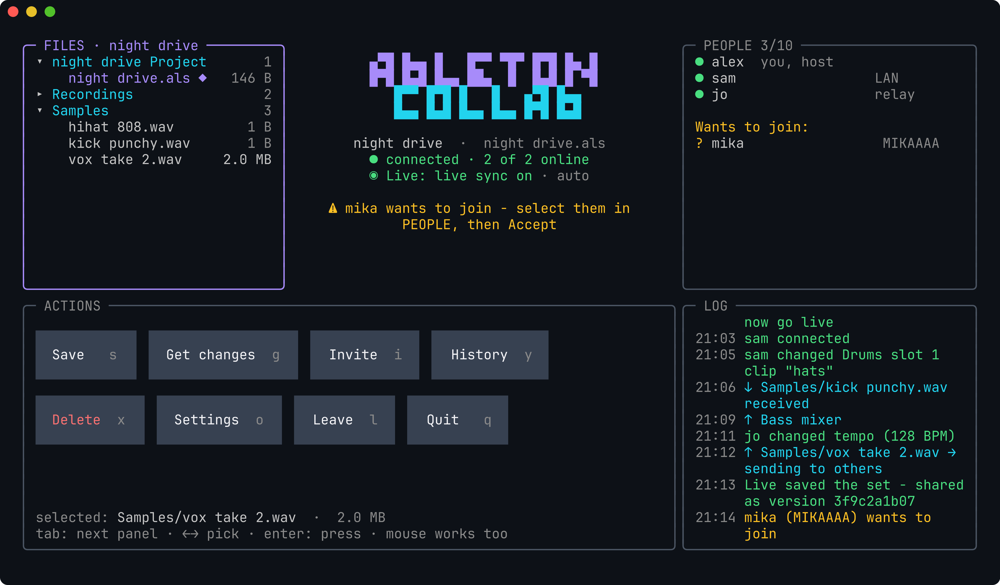
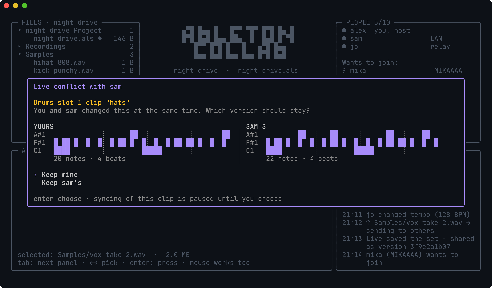
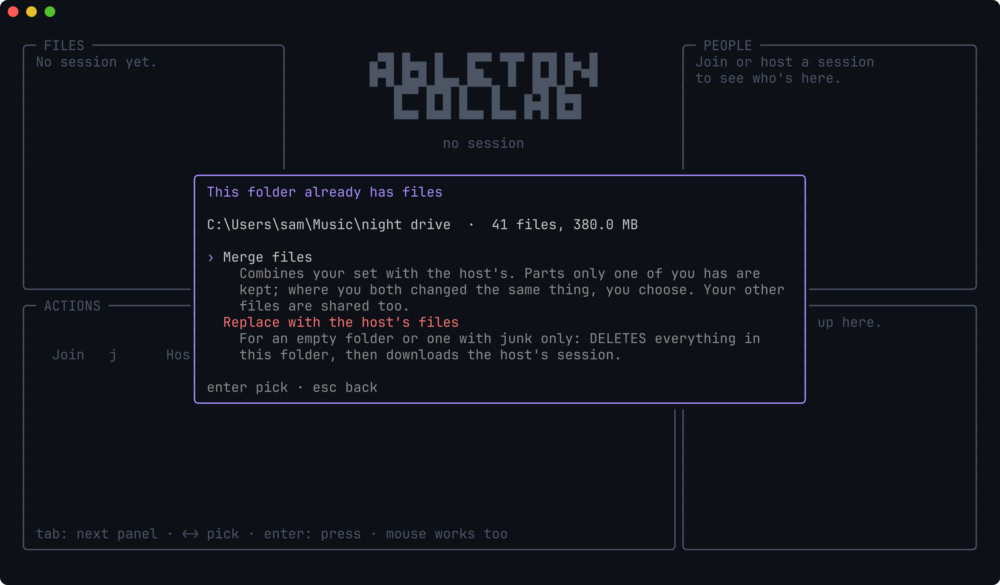

# ableton collab

Work on one Ableton Live project with friends, each on your own computer. One person edits the melody, another the hi-hats. Changes to different things merge automatically. When two people change the same clip, you pick which version to keep, with a preview of both patterns.

The merge works on the project's **structure** (tracks, clips, notes, devices), not on text lines. Files travel peer-to-peer through a bundled [Syncthing](https://syncthing.net): no server, no account, and it works behind CGNAT / mobile internet.



<table>
<tr>
<td></td>
<td></td>
</tr>
<tr>
<td align="center">Same clip changed by two people at once: pick which pattern stays</td>
<td align="center">Joining with your own copy: merge it or replace it</td>
</tr>
</table>

*Screenshots use example data. Regenerate them with `ABCOLLAB_SCREENSHOTS=<dir> go test ./internal/tui -run Screenshots` and [freeze](https://github.com/charmbracelet/freeze).*

## Install

**Windows** (PowerShell):

```powershell
irm https://raw.githubusercontent.com/c-airr/ableton-collab/main/install.ps1 | iex
```

**Linux / macOS**:

```sh
curl -fsSL https://raw.githubusercontent.com/c-airr/ableton-collab/main/install.sh | sh
```

Then open a new terminal and type `abcollab`. No admin rights needed. On first run it downloads Syncthing (checked by sha256).

## Use

- **Host**: pick a folder for the session. If there's no set in it yet, save one from Live into it (*File > Save Live Set As*). You get an invite code; send it to a friend.
- **Join**: paste the code. Use a new folder, or an existing one with your own copy of the project:
  - **Merge files** combines your set with the host's.
  - **Replace** deletes the folder's contents and downloads the host's files.
- The host accepts the request in **PEOPLE** after checking that the device code matches.
- **Live sync**: abcollab installs a small Remote Script, **AbletonCollab**. Pick it once in Live under *Settings > Link, Tempo & MIDI > Control Surface*. After that, note edits, clip name/color/loop, track volume/pan/mute/sends and tempo show up in everyone's open set within a second or two, with no reload. If two people edit the same clip at the same moment, syncing that clip pauses and both of you pick which version stays.
- **Automatic mode** (on by default):
  - saving in Live shares a new version, and others' versions come in on their own;
  - *Auto-save in Live* presses Ctrl+S for you a few seconds after you change something, only while Live is the window in front.
  - Both switches are in **Settings**.
- Changes that can't travel live (new devices or plugins, warping, routing) come with the next save. Others then get a **Reload set** button.

The whole session folder (samples, recordings…) is shared. Sets (`.als`) are never copied over each other: changes travel as versions and get merged.

Keys: `tab` moves between panels, arrows pick, `enter` presses. The letter next to a button is its shortcut. The mouse works too.

## Limitations

- Live's API can't save or reload a set. Auto-save sends Ctrl+S, which needs Accessibility permission on macOS and `xdotool` on Linux/Wine. **Reload set** writes the file; you reopen it in Live.
- Syncing only runs while `abcollab` is open.
- Plugin state is merged as a whole: if two people tweak the same plugin, one version wins.
- Tested with Live 12 on Windows and Linux (Wine). macOS builds exist but are untested.

## Build

```sh
go build ./cmd/abcollab
go test ./...    # ABCOLLAB_SYNCTHING=<path to syncthing> also runs the real pairing test
```

Releases are built by GitHub Actions on a `v*` tag.

## License

Apache License 2.0. Syncthing is MPL-2.0 and is downloaded unmodified from its official releases.
